# Turntable Dragon

A printed dragon curls on a geared turntable. A webcam watches your face: **smile and the dragon spins, then it keeps going for 10 s (about 3 turns) after you stop.**

A solo project on **expressive mechanics** for a physical computing class, built in four days (Nov 9–12, 2026). It began as a camshaft automaton with cams, push rods and flapping wings. That design jammed, so I pivoted to a single geared turntable. The interaction pivoted too: the original "scream to make it move" became "smile to make it spin." This README covers both versions and why things changed.

| Final: geared turntable | Underneath: ring gear and motor pinion |
|---|---|
| 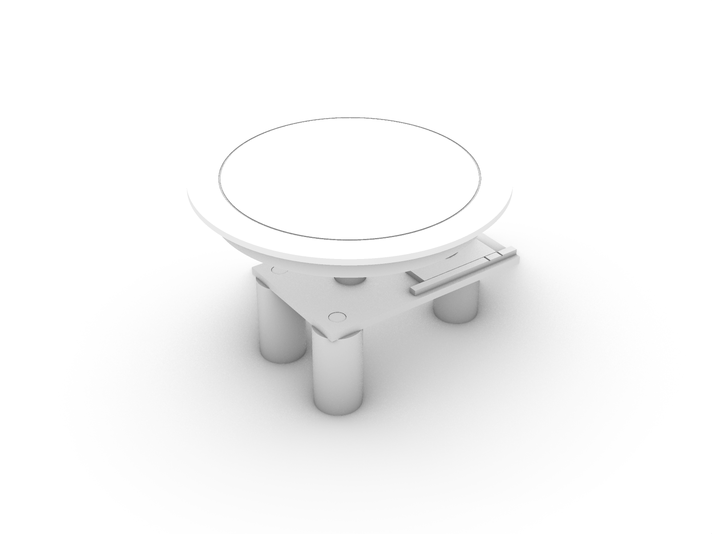 | 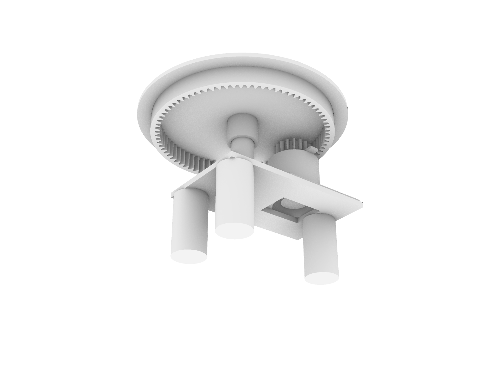 |

---

## How it works now

```
webcam -> smile_dragon.py (MediaPipe FaceMesh) --"S100"/"S0" over USB--> Elegoo Uno R3 --PWM--> L298N --> Mini-300 gearmotor
                                                                                                           |
                                                       28-tooth pinion -> 80-tooth internal ring gear under a 150 mm platter -> dragon
```

- **Smile detection** ([`smile_dragon.py`](Turntable_Dragon_Files/XX_3_CODE/smile_dragon.py)):
  - The smile measure is mouth width (landmarks 61/291) divided by face width (234/454).
  - It's compared with your relaxed face, captured in a 2 s calibration.
  - A smile above +10% held for 0.15 s starts the motor. It keeps spinning for 10 s after the last smile, and smiling again restarts the timer.
  - Talking or opening your mouth doesn't widen it, so only a smile counts.
- **Firmware** ([`dragon_motor.ino`](Turntable_Dragon_Files/XX_3_CODE/dragon_motor/dragon_motor.ino)):
  - It reads `S<0-100>\n` at 115200 baud. `S0` means stopped; anything higher means full speed.
  - Speed changes ramp smoothly.
  - If the laptop goes quiet for 2 s, the motor stops.
- **Mechanism:**
  - The platter has an **internal ring gear** (80 teeth, module 1.5) and spins on a centre post.
  - A 28T pinion (2.86:1) or a 17T pinion (4.7:1) on the motor drives it.
  - Everything prints on one Bambu plate in about 3–4 h.
- **Power:**
  - A 6 V adapter feeds the L298N's motor terminal. The L298N loses about 2 V, so the motor sees about 4 V.
  - The Uno runs from laptop USB.
  - The two boards share a ground.

### Run it
```bash
cd Turntable_Dragon_Files/XX_3_CODE
python3 -m pip install opencv-python mediapipe==0.10.14 pyserial numpy   # once
arduino-cli compile --fqbn arduino:avr:uno dragon_motor && arduino-cli upload -p /dev/cu.usbmodem* --fqbn arduino:avr:uno dragon_motor
python3 smile_dragon.py            # keep a relaxed face for 2 s, then smile
```
- **c** recalibrates.
- **Space** forces it on for 3 s.
- **q** quits and stops the motor.

---

## The pivots

### 1. Concept: a camshaft automaton (Nov 9)
The first idea was a classic automaton. A hand-crank or motor turns a camshaft, and cams under the dragon push rods up and down so a wave runs along its body from tail to head. Wings flap, and a snail cam lifts the head slowly and drops it.

| Crankshaft reference | Whiteboard sketch | Annotated: dowels, foot plate, DC motor, barrel jack |
|---|---|---|
| 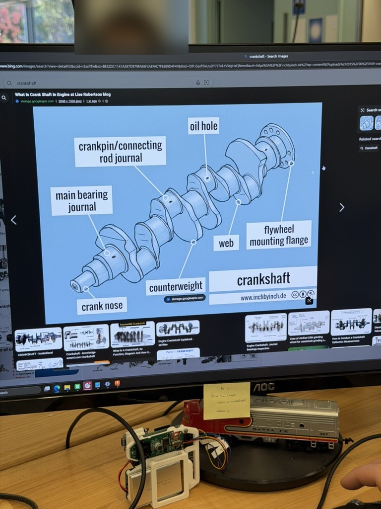 | 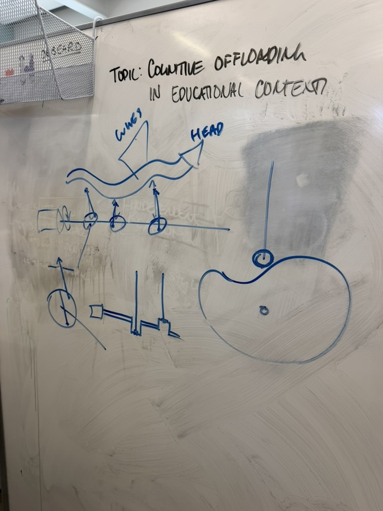 | 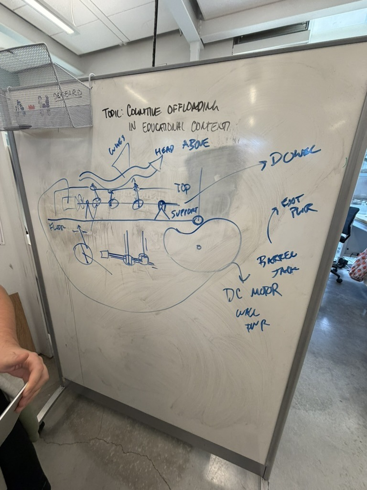 |

### 2. Building the automaton (Nov 9–11)
- **Modelling:** the whole machine was modelled parametrically in Rhino with Python ([`dragon_automaton.py`](dragon_automaton.py)). Every clearance lives in one `FIT_*` block, checked against a printed **fit-test ladder**.
- **Box:** laser-cut 1/8 in plywood with finger joints and an acrylic front window ([`Laser_Cut/`](Laser_Cut)).
- **Mechanism:** six cams (tail, back, belly, neck, wing and a head snail cam) drive push rods. The rods hold printed cradles that carry a 125%-scale D3Craft Flexi Dragon. The wings are scripted ([`wing_concepts.py`](wing_concepts.py)).
- **Prints:** split across 8 plates ([`Dragon_Automaton_Files/`](Dragon_Automaton_Files)). Even the camshaft was printed (an 8 mm D-shaft at 100% infill).

| In the box | Mechanism without the box |
|---|---|
| 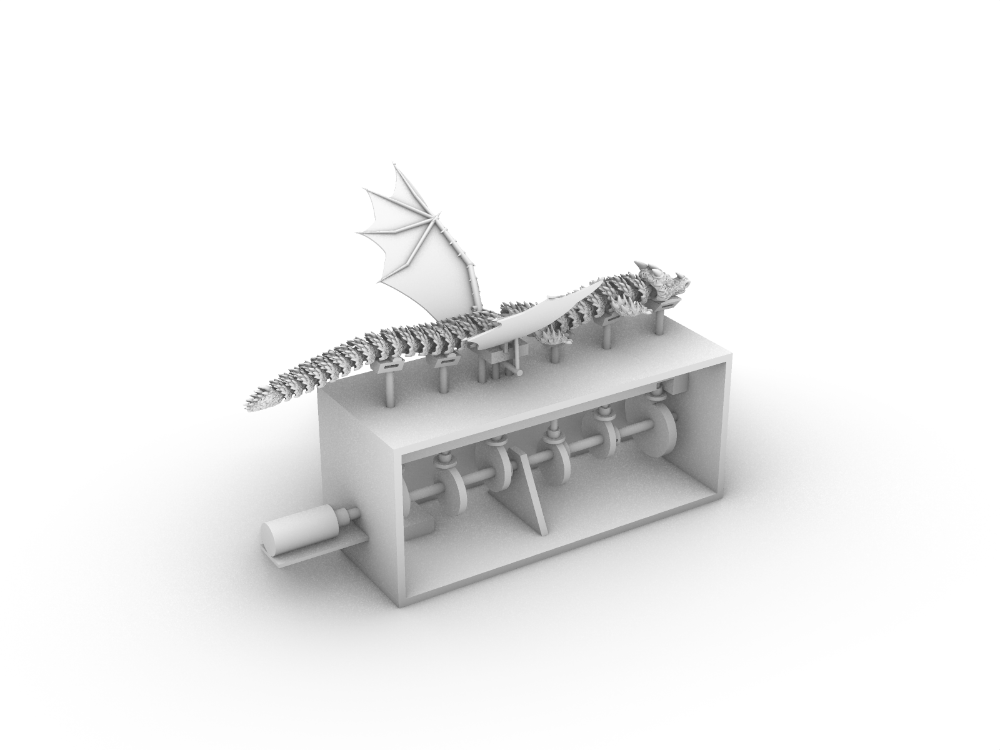 | 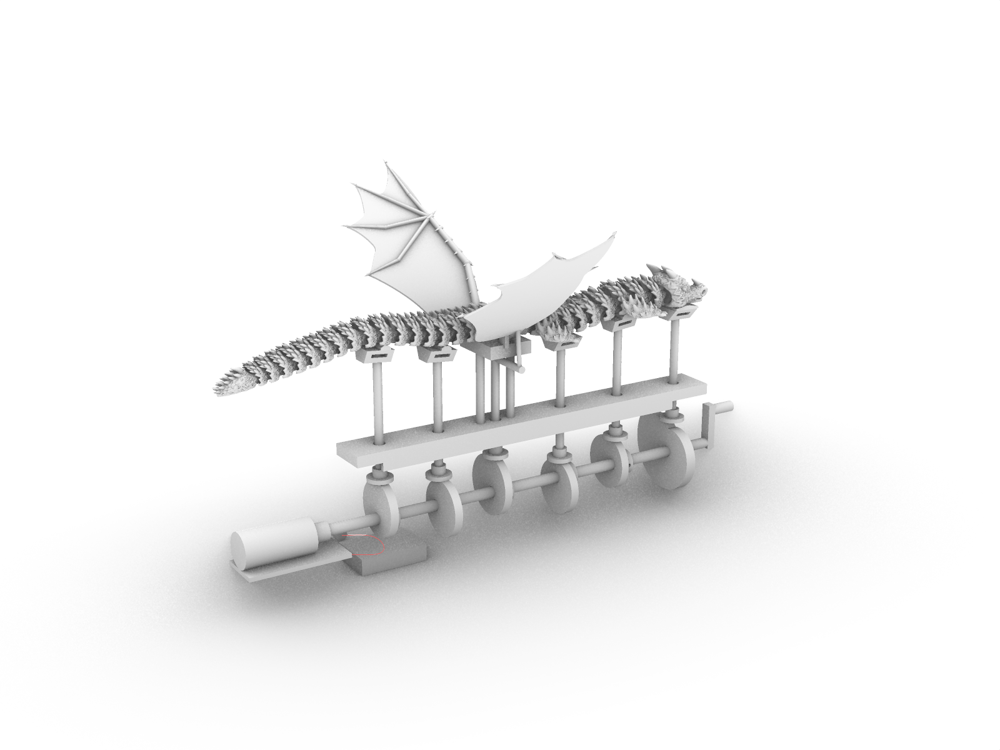 |

| Rhino work-in-progress | Kit parts: Uno, L298N, gearmotor | Printed rods and motor |
|---|---|---|
| 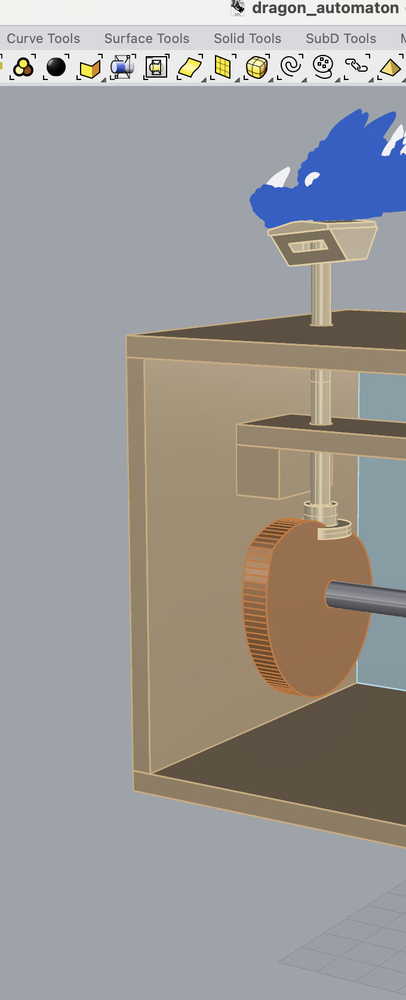 | 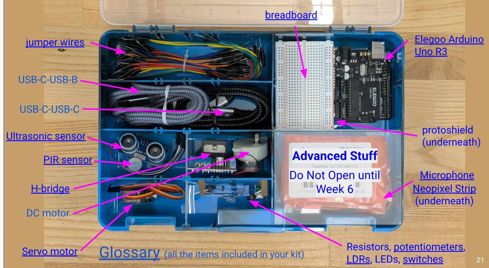 | 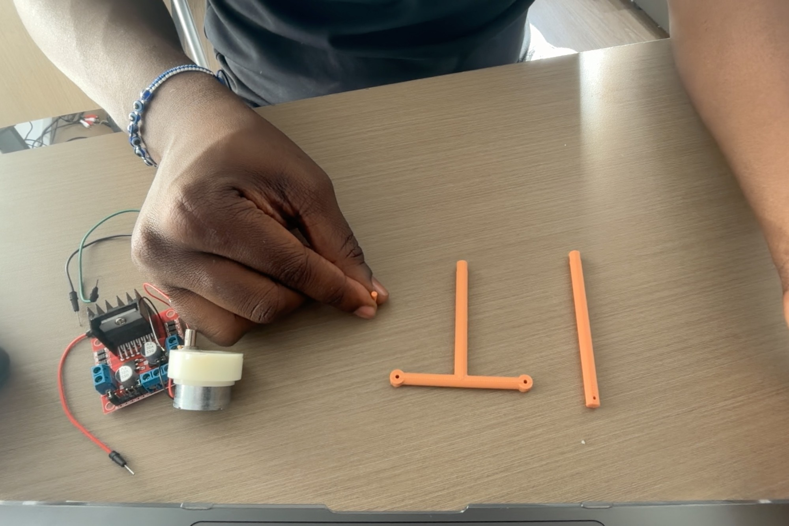 |

### 3. Why the automaton was dropped (Nov 11–12)
Problems piled up during assembly:
- **Hinge pins:** the 1.75 mm filament pins didn't fit the small hinge holes on plate 4. I accepted a slightly stiffer dragon instead.
- **The shaft jammed.** A 10°-step sweep of the full turn in Rhino found the cause: the **head push rod's foot** hit the right guide block for most of the turn, and it rose about 2 mm into the underside of the guide bar at the top of the snail cam. A reprinted guide bar with a clearance pocket (XX_8) and a trimmed foot didn't help. **The shaft still wouldn't turn freely.**
- **Too many parts:** six cams, six rods, cradles, wing linkages and a two-piece printed shaft all have to line up within fractions of a millimetre. With a demo the next day, that was too many places to bind.

At about 3 AM on Nov 12 I **pivoted entirely: fewer cams, more gears.** I kept the printed dragon, the Uno and H-bridge, the motor and the control code, and replaced the mechanism with one gear pair under a lazy-Susan platter.

### 4. The turntable (Nov 12)
- **Model:** [`turntable_dragon.py`](turntable_dragon.py) and [`turntable_plates.py`](turntable_plates.py).
- **Parts:** a 150 mm platter with an inner ring gear, a base deck with a centre post, three plug-in legs, a sliding motor carriage, and four pinions (28T or 17T, each in a tight and a loose fit). They all fit on **one plate** ([`Turntable_Dragon_Files/`](Turntable_Dragon_Files)).
- **Tolerances:** 0.6 mm of total tooth backlash. Groove marks on the rails set the gear mesh, and a single-point rounded post tip keeps friction low. Rhino checked the gears at both pinion sizes: the teeth never touch through a full turn.
- **Pinion fit:** each pinion has a dual-D bore and slides onto the shaft with no glue, with an optional M3 set screw.

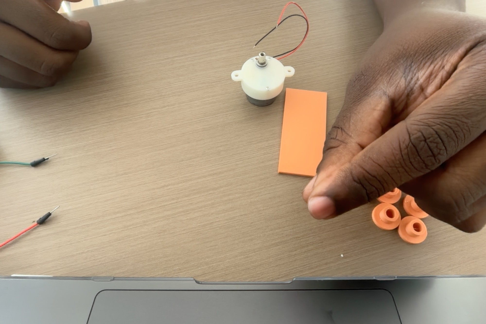

### 5. Bench testing: power and wiring (Nov 12)
Full test log: [`XX_ARDUINO_TESTING_HANDOFF.md`](Turntable_Dragon_Files/XX_ARDUINO_TESTING_HANDOFF.md).
- **USB power was too weak.** The L298N's ~2 V drop left the motor about 3 V from USB, so "calm" and "full speed" looked almost the same. The fix was a **6 V adapter** on the L298N motor terminal, which gives about 4 V at the motor. `MIN_PWM` and `IDLE_PCT` were retuned to match.
- **Reversing failed.** Flipping direction in code left the motor silent. The motor ran with IN1 HIGH / IN2 LOW but not with IN1 LOW / IN2 HIGH, so the IN2 signal wasn't reaching the L298N. With the demo close, I **swapped the motor leads on OUT1/OUT2** instead. That reverses the motor in hardware and doesn't need IN2.
- **Full speed only.** With only about 4 V available, the speed range was small, so I run the motor at full speed.

### 6. Interaction: from scream to smile (Nov 12)
- **Original:** [`scream_dragon.py`](Turntable_Dragon_Files/XX_3_CODE/scream_dragon.py) scored "anguish" from 0 to 100. It blended how wide your mouth opened (65%) with microphone loudness above the room baseline (35%), and the dragon sped up the more you screamed.
- **Final:** [`smile_dragon.py`](Turntable_Dragon_Files/XX_3_CODE/smile_dragon.py) is a simple **switch: smile and it spins for 10 s.** It suits the hardware better, since full speed versus stopped is easy to see, while small speed changes weren't. It also doesn't need a quiet room or a microphone.
- **First-run bug:** calibration ran before a face was in view, so the script had no baseline and never detected a smile. Now it keeps calibrating until it sees a face, and it logs its readings to the console.

### Next: dragon eggs
[`dragon_eggs.py`](dragon_eggs.py) generates small textured eggs to scatter on the turntable: scales, spiral ridges and gem studs. They print standing with no supports. Plate: `XX_EGGS_30_small_dragon_eggs.3mf`. The STLs are in [`STL_eggs/`](STL_eggs).

---

## Repo layout
| Path | What |
|---|---|
| `Turntable_Dragon_Files/` | **Final build**: one-plate print, firmware, smile and scream scripts, read-me and testing handoff |
| `Dragon_Automaton_Files/` | The abandoned camshaft automaton: laser-cut files, 8 print plates, code |
| `STL/`, `STL_turntable/`, `STL_eggs/`, `Laser_Cut/` | Individual exported parts |
| `*.py` (root) | Rhino Python generators: `dragon_automaton.py`, `printed_hardware.py`, `motor_cover.py`, `wing_concepts.py`, `laser_box_fingers.py`, `turntable_dragon.py`, `dragon_eggs.py`, etc. |
| `BUILD_NOTES.md` | Automaton fits, print orientation, assembly order |
| `docs/images/` | Photos, whiteboard sketches and Rhino renders |

**Not included:**
- **The dragon model:** the *Flexi Dragon* by **D3Craft** (MakerWorld) is under a personal-use licence, so get it from MakerWorld.
- **The Rhino `.3dm` file:** it's about 200 MB. The Python generators rebuild it.

## Credits
- The dragon is the Flexi Dragon by D3Craft (MakerWorld, Standard Digital File License).
- The kit glossary image is from the course materials.
- I developed the CAD and code with Claude Code.
